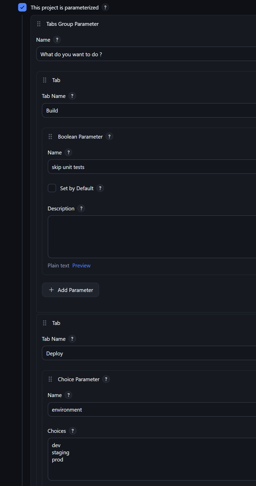
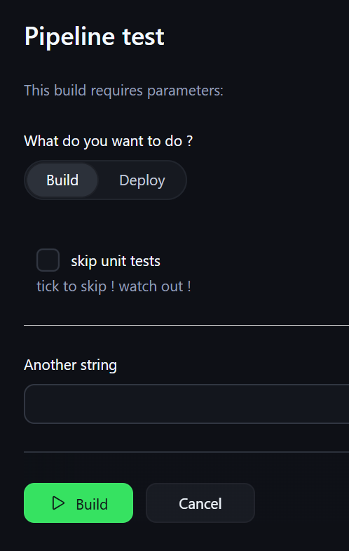
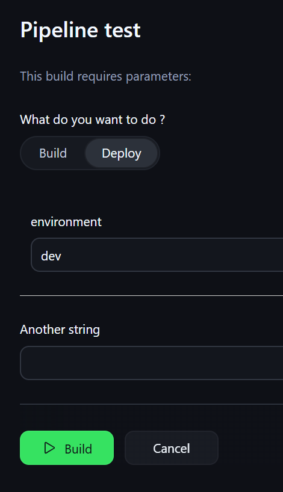

# tabs-parameter-plugin

## Introduction

This plugin provides Tabs in the "Build with parameters" view.
The style try to match to Jenkins style.
The implementation uses only base Jenkins classes and native and simple HTML/CSS/JS.

Example of build configuration :


Example of "build with parameters" view:

First tab:



Second tab:



## Getting started

Install the plugin on your Jenkins instance. 
Add a "Tabs parameter" as you would add any other [build parameter](https://plugins.jenkins.io/build-with-parameters/)

Then you can access the parameters of the tab selected by the user with `params.tabGroupName.selectedParams.paramName` in your pipeline job.
You can also access the selected tab name as `params.tabGroupName.selectedTab`.
You can also access the parameters through environment variables as `env.(tabGroupName.selectedParams.selectedTab)`.

The layout of the parameter is defined like : 

```
params
└── tabGroupName
    ├── selectedTab <= This contains the name of the selected tab
    └── selectedParams
        ├── paramName1
        └── paramName2
```

## Triggering a build from the API

The tab group parameter is selected with its name and the zero-based index of the tab.
The parameters inside the tabs are sent with their own names. Missing ones use their default value.

```shell
curl -X POST "https://jenkins.example.com/job/my-job/buildWithParameters" \
  --user "user:api-token" \
  --data-urlencode "tabGroupName=1" \
  --data-urlencode "paramName1=value"
```

Here `tabGroupName=1` selects the second tab. The first tab is selected when it is omitted.
An index out of range makes the request fail.

## Limitations:

* Recursion of tabs groups is not supported (a tab group cannot contain another tab group)
* Not tested compatibility with rebuild plugin
* Only tested with base Jenkins Parameters
* When triggering a build from the API, the tab is selected by index, so reordering tabs changes which tab is selected
* Only selected tab parameters are sent to the build

## Technical Infos

At first, I tough I needed to reimplement the way the parameters where rendered, which lead me to Jenkins core
territory, something that I don't wanted to try.
Now I think my implementation is not _that_ hacky.

Inspired by uno choice plugin.

## Issues

Lookup the GitHub Issues tab

## Contributing

See [CONTRIBUTING](https://github.com/jenkinsci/.github/blob/master/CONTRIBUTING.md)

Refer to our [contribution guidelines](https://github.com/jenkinsci/.github/blob/master/CONTRIBUTING.md)

## LICENSE

Licensed under MIT, see [LICENSE](LICENSE.md)

